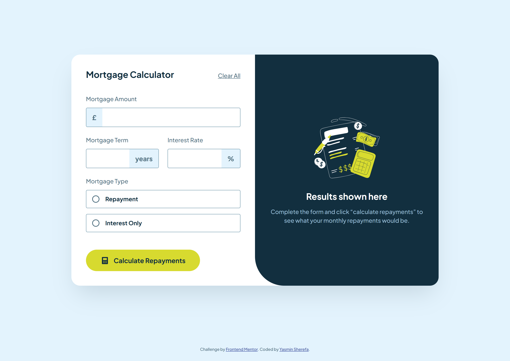
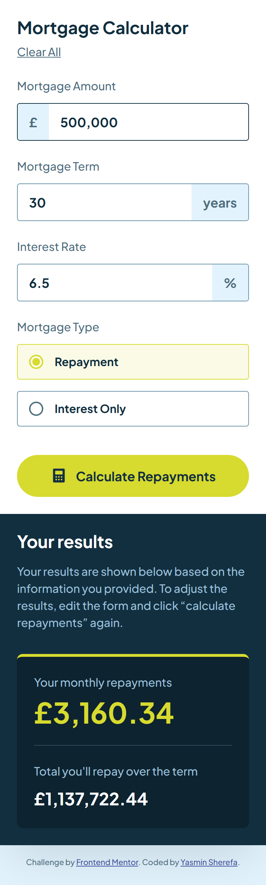

# Mortgage repayment calculator

My solution to the Mortgage repayment calculator challenge on [Frontend Mentor](https://www.frontendmentor.io/challenges).

## Screenshots

| Desktop | Mobile |
| --- | --- |
|  |  |

## Overview

The goal of this challenge was to build a mortgage calculator that takes the loan amount, term, interest rate and mortgage type, then shows the monthly and total repayments.

Users can:

- Enter their mortgage details and see the monthly and total repayment after submitting
- See an error message under every field that is empty or invalid
- Complete the whole form with the keyboard only
- See hover and focus states on all interactive elements
- Use the calculator on mobile and desktop
- Reset the form with "Clear All"

## Built with

- Semantic HTML5
- CSS custom properties
- Flexbox and CSS Grid
- Mobile-first workflow
- Vanilla JavaScript
- Plus Jakarta Sans font, loaded locally

## How I built it

**HTML:** a `form` with `novalidate`, so I control the error messages. Each input has a `label`, and the mortgage type is a `fieldset` with a `legend`. The results sit in an `aria-live="polite"` region so changes can be announced by screen readers.

**CSS:** mobile-first, with two breakpoints. At `30rem` the term and interest rate fields sit side by side, and at `50rem` the layout switches to two columns. Colors and the font are CSS variables from the style guide. Each input and its "£", "years" or "%" box form one bordered group, so the focus and error states (`:focus-within` and an `is-invalid` class) style the whole group at once.

**JavaScript:**
1. On submit, each field is checked: empty, not a number, zero, or too large.
2. If anything is wrong, error messages are shown, `aria-invalid` is set, and focus moves to the first invalid field.
3. If everything is valid, the repayment is calculated and formatted as GBP with `Intl.NumberFormat`.

**Formula (repayment):** `M = P × r(1 + r)^n / ((1 + r)^n − 1)`, where `P` is the amount, `r` is the monthly rate (annual rate ÷ 12 ÷ 100) and `n` is the number of months.

**Interest only:** the design doesn't show this case, so I made a choice. The monthly payment is `P × r`, and the total is that payment times the number of months. This total leaves out the original loan, which is still owed at the end of the term.

## What I learned

- How to validate a form manually and connect each error to its field with `aria-describedby`.
- How to style a custom radio button while keeping the real input for keyboard use.
- How to use `:focus-within` and `:has()` to style a parent based on its children.
- How to format currency in JavaScript with `Intl.NumberFormat`.

## Continued development

- Test the results announcement with a screen reader such as NVDA. I added the `aria-live` region but have not tested it yet.
- Add a tablet layout.
- Run an automated accessibility check such as Lighthouse or axe.

## Run it locally

Open `index.html` in your browser, or use the Live Server extension in VS Code.

## Author

Yasmin Sherefa